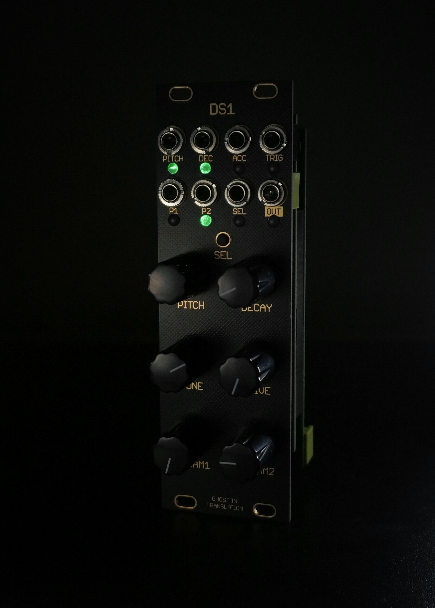

# DS1

DS1 is a modular Drum Synthesizer based on my Motherboard platform. 

Available on https://www.ghostintranslation.com/

This module is going to be fully open-source, but I have yet to document everything.

## User Manual

The complete user manual, including controls, algorithm guide, looper operation, and firmware update instructions, is available in PDF format:

👉 **[Download the User Manual (PDF)](./docs/user-manual.pdf)**

## Firmware

The firmare can be found in this repo under firmware, here is a quick link: 

👉 **[Download the latest firmware](./firmware/ds1_1.0.1.uf2)**